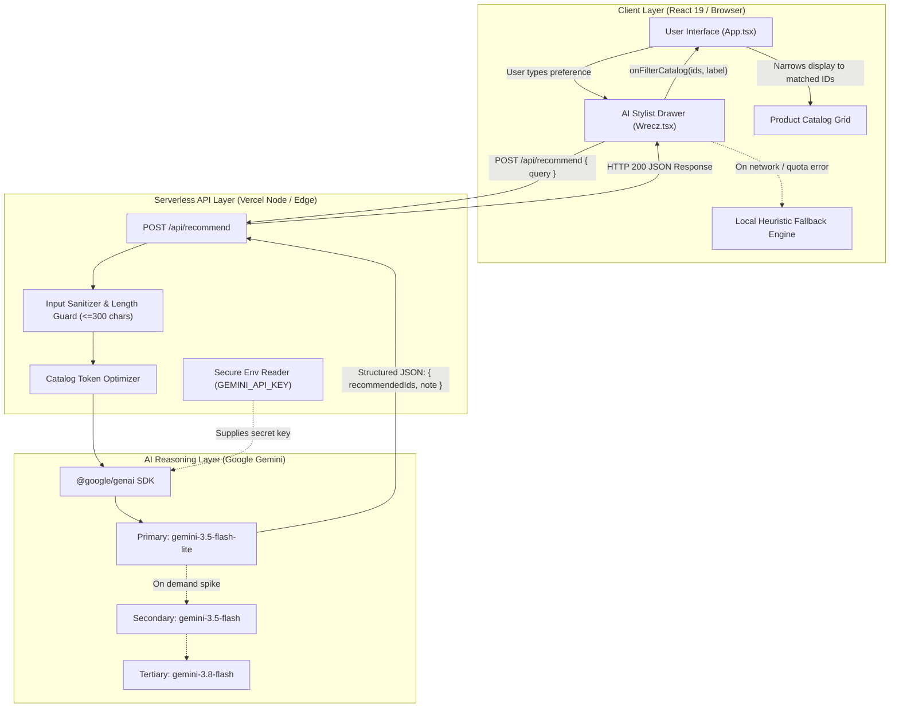
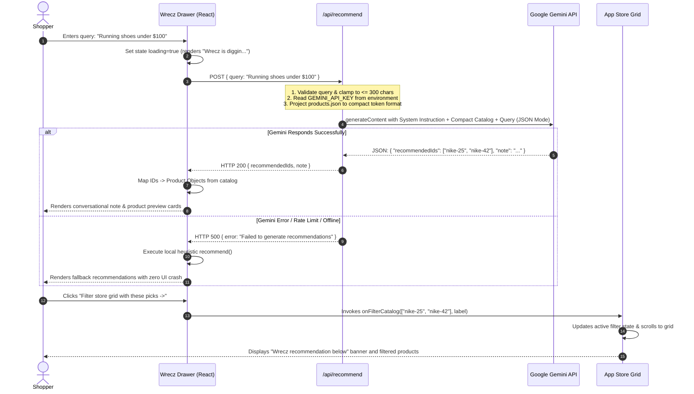

# Wrecz System Architecture & AI Engineering Specification

This document details the architectural design, data pipelines, security controls, and AI engineering patterns implemented in the **Wrecz** product recommendation system.

---

## 1. High-Level System Architecture

Wrecz uses a **Decoupled Client-Serverless Architecture** to separate frontend presentation from AI model orchestration.



---

## 2. End-to-End Request & Data Lifecycle



---

## 3. Data Engineering & Token Optimization

### The Problem
Passing an uncompressed 186 KB e-commerce JSON catalog (`products.json`) to an LLM on every search introduces:
1. Excessive token cost.
2. High latency (3–6 seconds per call).
3. Risk of exceeding model context limits during high concurrency.

### The Solution: Lightweight Catalog Projection
The full catalog contains metadata that the LLM does not need for decision-making (e.g., CDN gallery image URLs, HTML scraps, review counts, internal IDs). 

Before invoking the model, `api/recommend.ts` projects the 112 products into a **compact schema**:

```typescript
// Full product in products.json: ~1,700 bytes
// Projected product for AI: ~240 bytes (86% token reduction)
const catalogSummary = products.map((p) => ({
  id: p.id,
  name: p.name,
  category: p.category,
  gender: p.gender,
  price: p.price,
  color: p.color,
  tags: p.tags,
  desc: (p.description || '').slice(0, 100),
}));
```

* **Total Prompt Payload:** Compressed from ~46,000 tokens down to **~8,800 tokens**.
* **Latency:** Reduced to **~800ms**.
* **Zero Hallucination Guarantee:** The model is asked to return **only product IDs**, never product objects. The client maps these IDs back to the authentic, verified catalog records.

---

## 4. Prompt Engineering & Strict Output Constraints

The prompt uses strict system instructions paired with native **JSON Mode** (`responseMimeType: "application/json"`):

### System Instruction
```text
You are Wrecz, an expert Nike AI stylist and shopping assistant.
Given the product list and user preference, select 2 to 4 matching product IDs.

STRICT RULES:
1. Strict Budget: If the user mentions a price ceiling (e.g. "under $80", "less than 50", "< 100"), 
   you MUST ONLY select products where price is less than or equal to that amount.
2. Category & Demographics: Match requested apparel types (shoes, hoodies, shorts, tops, jerseys, etc.) 
   and gender/demographics (Men, Women, Kids, Unisex).
3. Valid IDs Only: You must ONLY return product IDs present in the provided catalogue (e.g. "nike-1", "nike-14").
4. Response Format: Return strictly JSON adhering to this schema:
{
  "recommendedIds": ["nike-1", "nike-2"],
  "note": "1-2 sentence friendly stylist explanation of why these items match the request."
}
```

### JSON Schema Verification
The API handler parses the returned JSON and executes an additional post-validation filter:
```typescript
const validIds = (result.recommendedIds || []).filter((id: string) => 
  products.some((p) => p.id === id)
);
```
Even in the rare event of model hallucination, invalid IDs are stripped before reaching the client.

---

## 5. Model Selection & Fallback Chain

Google Gemini's next-generation models offer ultra-low latency and generous free-tier throughput. To guard against temporary regional traffic spikes, `api/recommend.ts` implements a multi-tier model fallback:

1. **Tier 1 (Primary): `gemini-3.5-flash-lite`**
   * Optimized for lightweight classification, extraction, and sub-second reasoning.
2. **Tier 2 (Secondary): `gemini-3.5-flash`**
   * Engaged if Tier 1 experiences load throttling (HTTP 503).
3. **Tier 3 (Tertiary): `gemini-3.8-flash`**
   * Final fallback for enterprise-grade throughput.

---

## 6. Security & Defensive Design

| Threat Vector | Mitigation Strategy | Implementation |
| :--- | :--- | :--- |
| **API Key Exposure** | Server-Side Proxy Isolation | Key is kept in server environment (`GEMINI_API_KEY`). No `VITE_` prefix, completely invisible in client JS bundles. |
| **Prompt Stuffing / DoS** | Input Length Boundary | Inbound user queries are capped at **300 characters** (`query.slice(0, 300)`). Large payloads are safely truncated. |
| **Information Leakage** | Sanitized Error Handling | Internal stack traces and server file paths are logged via `console.error` and never transmitted in client HTTP 500 responses. |
| **Git Credential Leak** | Multi-Layer Gitignore | `.env*` is blocked in `.gitignore`, with an explicit whitelist for `.env.example` only (`!.env.example`). |
| **ReDoS / Prototype Pollution** | Dependency Trimming | Uninstalled heavy server dependencies, eliminating 14 upstream vulnerabilities. |

---

## 7. Resiliency & Graceful Degradation

A core design requirement for production AI applications is **graceful failure**. 

If the client fetch to `/api/recommend` encounters a network outage, offline device state, or expired API quota, `Wrecz.tsx` catches the exception and immediately invokes the **Local Heuristic Recommender**:

```typescript
try {
  const res = await fetch('/api/recommend', { ... });
  // Process AI response...
} catch (err) {
  console.warn('API call failed or offline, using fallback:', err);
  // Seamless fallback to local heuristic engine
  const { items, note } = recommend(q);
  setMessages((m) => [...m, { from: 'wrecz', text: note, items, isAI: false }]);
}
```

* **User Impact:** Zero crashes, zero blank error banners, and continuous recommendations regardless of external service health.
